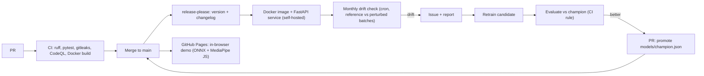

# Fall Detection

This Python project leverages AI to automatically detect falls in video streams. 
It uses **MediaPipe** to extract body joint coordinates and a **1D Convolutional Neural Network (CNN)** to analyze temporal sequences and identify falls in real-time. The system includes an integrated alert system (audio and notifications) to ensure rapid and effective intervention.

## Pipeline at a glance



| Stage | Status | Where |
|---|---|---|
| CI, security scans, release automation | in place | `.github/workflows/` |
| Out-of-video evaluation | in place | [docs/EVALUATION.md](docs/EVALUATION.md) |
| In-browser demo (no server, nothing uploaded) | in this release | `site/`, `scripts/export_onnx.py` |
| API + Docker | in this release | `src/fall_detection/api.py`, `Dockerfile` |
| Monitoring (drift), promotion rule | planned | next PRs |

> Research prototype, **not a safety system**: out-of-video accuracy 82 %, recall 67 %.

## Demo

`site/index.html` is a static page: MediaPipe Pose Landmarker (JS) extracts the landmarks and the
exported ONNX model (`site/model.onnx`, 127 KB) scores each 30-frame window, all in the browser.
Hosting is free (GitHub Pages) and the video never leaves the machine.
Locally: `python -m http.server -d site` then open http://localhost:8000.
Regenerate the model after a promotion: `python scripts/export_onnx.py`.

Hugging Face Docker and Gradio Spaces require a paid plan, which is why the public demo is static.
The Docker image below runs the same model behind an API wherever you can host a container.

## API

```bash
docker build -t fall-detection .
docker run -p 7860:7860 fall-detection
# demo: http://localhost:7860/   API docs: http://localhost:7860/docs
curl -s localhost:7860/health
curl -s -F "file=@clip.mp4" localhost:7860/predict/video
```

`POST /predict` takes `{"landmarks": [[132 floats] x n_frames]}` (n >= 30) and returns whether
any 30-frame window crosses the threshold, plus each window score. The model runs server-side;
no key or secret is involved.


---

## Table of Contents
- [Features](#features)
- [Installation](#installation)
- [Usage](#usage)
- [Project Structure](#project-structure)
- [Model and Training](#model-and-training)
- [Alert System](#alert-system)
- [Results and Metrics](#results-and-metrics)
- [Future Improvements](#future-improvements)
- [Dependencies](#dependencies)
- [FAQ](#faq)
- [Author](#author)

---

## Features
- **3D Joint Coordinate Extraction**: Powered by **MediaPipe** for precise skeletal tracking.
- **Temporal Video Segmentation**: Processes video streams into 2-3 second temporal sequences.
- **1D CNN Model**: A specialized neural network trained for binary classification (Fall vs. No-Fall).
- **Anomaly Detection (Optional)**: Alternative approach using an **Autoencoder** to identify unusual movements.
- **Real-Time Detection**: Immediate processing with keyframe capture for event verification.
- **Audio Alerts**: Instant sound triggers when a fall is detected.
- **Event Logging**: Automatic recording of logs and video clips for each incident.
- **Notification System**: Built-in support for sending alerts (email/push notifications).
- **Camera Angle Robustness**: Handles various perspectives through:
  - **Invariant Features**: Calculations based on relative distances and joint angles.
  - **Data Augmentation**: Artificial dataset expansion using rotation techniques.

---

## Installation

1.  **Prerequisites**: Ensure you have **Python 3.8+** installed on your system.
2.  **Clone the repository**:
    ```bash
    git clone [https://github.com/gabrielkpo/Fall-detection.git](https://github.com/gabrielkpo/Fall-detection.git)
    cd Fall-detection
    ```
3.  **Install dependencies**:
    It is recommended to use a virtual environment (venv) before installing the requirements:
    ```bash
    pip install -r requirements.txt
    ```
---

## Usage

This project supports real-time detection via webcam, model training, and inference on existing video files.

### 1. Real-time Execution (Webcam)
To start the fall detection system using your default camera:
```bash
python scripts/run_webcam_alerts.py
```

### 2. Model Training
### 3. Inference on video files
To retrain the **1D CNN model** using your own preprocessed dataset, use the following command:

```bash
python scripts/train.py --data data/processed --epochs 50
```
---

### 3. Inference on Video Files
To run the fall detection model on a pre-recorded video file:

```bash
python scripts/predict.py --video data/videos/test_video.mp4
```
### 📂 Data Storage & Logs
Every time a fall is detected, the system generates a report stored in the `data/events/` directory. Each event includes:
* **Keyframes**: High-quality images captured during the fall.
* **Video Clips**: Short recordings of the detected incident.
* **Logs**: Detailed text files containing timestamps and detection confidence levels.
---
## Project Structure

The repository is organized as follows to ensure a clear separation between data, source code, and results:

- **`src/`**: Python modules (neural network models, data preprocessing, and utility functions).
- **`scripts/`**: Main execution scripts for training, inference, and real-time detection.
- **`data/raw/`**: Raw input data (original video files).
- **`data/processed/`**: Transformed data (processed sequences and extracted features).
- **`data/videos/`**: Test videos used for validation.
- **`data/events/`**: Recordings and logs of detected fall events.
- **`models/`**: Saved model weights and architecture files (.h5, .tflite, etc.).
- **`notebooks/`**: Jupyter notebooks for research, experimentation, and data analysis.

---

## Model and Training

### 1D CNN Architecture
The core of the detection system is a **1D Convolutional Neural Network** designed for temporal sequence analysis:
- **3 Convolutional Layers**: Optimized for feature extraction from movement data.
- **Filters**: 32 filters per layer with a **Kernel Size of 5**.
- **Output Layer**: Uses **AdaptiveMaxPool1d** to handle variable sequence lengths.

### Training Configuration
- **Loss Function**: Binary Cross-Entropy (ideal for Fall vs. No-Fall classification).
- **Metrics**: Accuracy, Precision, Recall, and F1-score.

### Anti-Overfitting Strategies
To ensure the model generalizes well to new environments and people:
- **Regularization**: Implementation of **Dropout** and **Weight Decay**.
- **Training Control**: **Early Stopping** to halt training once validation loss stabilizes.
- **Data Augmentation**: Artificial expansion of the dataset to improve robustness.

---

## Alert System

The system is designed to provide immediate feedback and documentation whenever a critical event occurs:

- **Real-Time Detection**: Continuous monitoring via webcam or video stream with low latency.
- **Immediate Audio Alert**: Triggers a sound signal the moment a fall is identified to alert nearby individuals.
- **Visual Evidence Capture**: Automatically saves a video clip and a high-resolution keyframe for post-event analysis.
- **Remote Notifications**: Configurable alert system for remote monitoring (e.g., email or push notifications).

---

## Results and Metrics

Out-of-video evaluation (5-fold, grouped by video, 294 windows): **accuracy 82 %, precision 78 %,
recall 67 %, F1 0.72**. About one fall in three is missed, so this is a research prototype, not a
safety system. Protocol, confidence intervals, sensitivity analysis and limits:
[docs/EVALUATION.md](docs/EVALUATION.md).

---

## Future Improvements

- **Multi-Camera Integration**: Supporting synchronized video feeds for better spatial coverage.
- **Hybrid Architecture (CNN + LSTM)**: Implementing a combined model to capture both spatial features and long-term temporal dependencies.
- **Dataset Expansion**: Adding more diverse scenarios, lighting conditions, and clothing to increase model robustness.
- **Embedded Deployment**: Optimizing the model (e.g., via Quantization or TFLite) for deployment on edge devices like Raspberry Pi or IoT modules.

---

## Dependencies

The project requires the following libraries and frameworks to be installed:

- **Python 3.8+**: Core programming language.
- **MediaPipe**: For real-time skeletal tracking and joint coordinate extraction.
- **OpenCV**: For video stream processing and image manipulation.
- **NumPy & Pandas**: For numerical computations and data frame management.
- **TensorFlow / PyTorch**: Deep learning frameworks used for model architecture and training (depending on implementation).
- **Matplotlib & Seaborn**: Used for data visualization and training performance monitoring.

---

## FAQ

**Q: Can I use this project with a standard webcam?**
A: Yes, any standard webcam is supported through OpenCV.

**Q: Does the model work offline?**
A: Yes, everything runs locally on your machine once the dependencies and models are downloaded.

**Q: How do I add my own training videos?**
A: Place your video files in the `data/raw/` directory, then use `scripts/preprocess.py` to convert them into the required format.

**Q: Can it detect events other than falls?**
A: Yes. By expanding the dataset and adjusting the classification labels, the model can be retrained to recognize other specific gestures or behaviors.
---


## Author

**Kpodoh Gabriel** 👨‍💻
*AI & Python Developer — 2025*

[](https://github.com/gabrielkpo)

Feel free to reach out for collaborations or questions regarding this project!
