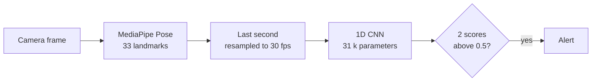
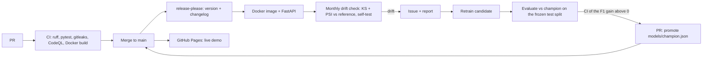

# Fall Detection

[](https://github.com/gabrielkpo/Fall-detection/actions/workflows/ci.yml)
[](https://gabrielkpo.github.io/Fall-detection/)
[](LICENSE)

Real-time fall detection from a camera: **MediaPipe pose landmarks + a 1D CNN**, served three ways:
a static in-browser demo (nothing is uploaded), a FastAPI service in Docker, and local scripts.

> **Research prototype, not a safety system.** Measured out-of-video: accuracy 82 %, recall 67 %
> (about 1 fall in 3 is missed, false alarms happen). See [docs/EVALUATION.md](docs/EVALUATION.md).

**Try it:** https://gabrielkpo.github.io/Fall-detection/ (camera or a video file, runs in your browser)

## How it works



The same model runs in the browser (ONNX Runtime Web), in the API (PyTorch) and in the local scripts.

## Pipeline



## Quick start

```bash
pip install -e ".[train,dev]"
python scripts/run_webcam_alerts.py          # camera, sound alarm, desktop notification
```

**API in Docker**

```bash
docker build -f docker/Dockerfile -t fall-detection .
docker run -p 7860:7860 fall-detection
curl -s localhost:7860/health
curl -s -F "file=@clip.mp4" localhost:7860/predict/video
```

`POST /predict` takes `{"landmarks": [[132 floats] x n_frames]}` (n >= 30) and returns the fall
flag, the maximum window score and each window score. Interactive docs at `/docs`.

**Browser demo locally:** `python -m http.server -d site`, then open http://localhost:8000.

## Results

| Protocol | Accuracy | Recall | Precision | F1 |
|---|---|---|---|---|
| 5-fold CV grouped by video (294 windows) | 82.3 % | 67.0 % | 77.9 % | 0.72 |
| Frozen test split (61 windows, champion 0.2.0) | 85.2 % | 80.0 % | 76.2 % | 0.78 |

The second row has wide intervals (accuracy 74-92 %, recall 58-92 %) and is **not** an
improvement over the first. Details, sensitivity analysis and limits:
[docs/EVALUATION.md](docs/EVALUATION.md).

Known limits: small single-person dataset, results do not transfer reliably to other people,
rooms or camera angles; random landmarks are scored as a fall; pose extraction (not the model) is
the latency bottleneck.

## Repository layout

| Path | Content |
|---|---|
| `src/fall_detection/` | Model, inference, API, features, evaluation, monitoring, promotion |
| `scripts/` | Training, webcam demos, ONNX export, dataset extraction, monitoring entry point |
| `site/` | Static in-browser demo and the exported ONNX model |
| `models/` | Champion weights and metadata, frozen test split, drift reference |
| `docker/` | Dockerfile for the API |
| `docs/` | Evaluation report |
| `tests/` | Unit tests |
| `.github/` | CI, scans, release, monthly monitoring, promotion workflows |

## Development

```bash
pip install -e ".[train,dev]"
pre-commit install      # ruff, ruff-format and gitleaks before each commit
pytest
```

Pull requests need a [Conventional Commits](https://www.conventionalcommits.org/) title
(`feat: ...`, `fix: ...`). CI runs ruff, pytest, a Docker build, gitleaks and CodeQL. Versions
and the changelog are automated with release-please. Regenerate the browser model after a
promotion with `python scripts/export_onnx.py` (extra: `pip install -e ".[export]"`).

Raw training data is not in the repository (its origin and licence are not documented).
Promotion (`python -m fall_detection.promotion`) needs `data/processed/X.npy` and `y.npy`.

## Author

Gabriel Kpodoh, [@gabrielkpo](https://github.com/gabrielkpo). MIT licence.
